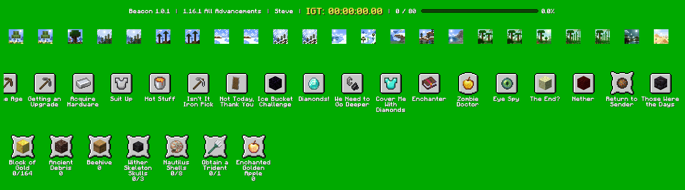
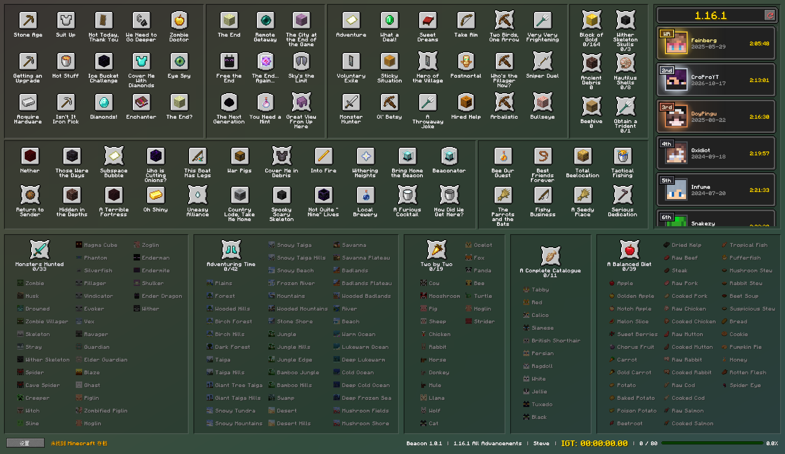

<div align="center">
  
  <h1>Beacon</h1>
  <p><strong>An advancement tracker for Minecraft speedruns.</strong></p>
  <p>
    <a href="https://github.com/liaozhangsheng/beacon/actions/workflows/ci.yml"></a>
    <a href="LICENSE"></a>
  </p>
  <p><a href="#beacon">English</a> · <a href="README_zh.md">中文</a></p>
</div>

Beacon reads Minecraft save data and turns advancements, statistics, and custom rules into a live speedrun checklist. It provides a main window, an optional overlay, and a template package format for describing your own runs.

<p align="center">
  
</p>
<p align="center">
  
</p>

## Highlights

- **Live advancement tracking** — discovers worlds and players, then refreshes the active save while you play.
- **Advancements and statistics** — reads the standard `stats/<uuid>.json` and `advancements/<uuid>.json` files without modifying the save.
- **Main window and overlay** — use the full tracker or a compact, configurable overlay during a run.
- **Version-aware templates** — each template declares the Minecraft `DataVersion` range it supports.
- **Resilient refresh** — keeps the last successful state visible when a file is temporarily unavailable or still being written.
- **Customizable runs** — define goals, rules, languages, layouts, and icons in a template package.
- **Cross-platform desktop app** — designed for Windows, macOS, and Linux.

## For users

### Getting started

1. Build or download Beacon for your platform.
2. Launch `beacon`. It starts with the bundled **1.16.1 All Advancements** template; open settings to choose your Minecraft game directory, or another template from `templates/` in the installation root (see [Custom templates](#custom-templates)).
3. Select a world and player, then start playing. Beacon updates the checklist as the save changes.

The default Minecraft directories are detected automatically:

| Platform | Default game directory |
| --- | --- |
| Windows | `%APPDATA%/.minecraft` |
| macOS | `~/Library/Application Support/minecraft` |
| Linux | `~/.minecraft` |

The installation root is the directory containing the `beacon` launcher. Beacon ships the `templates/1.16.1` template, which tracks every Minecraft Java Edition 1.16.1 advancement in Chinese and English. Without any template, it exits with `no templates found`.

The interface defaults to Chinese. In settings, change **界面语言** (Interface language) to **English** to switch the app's labels.

The **Auto detect** setting is on by default. When you switch to the Minecraft window, Beacon reads the game's `--gameDir` argument and looks for the active world under `saves`. If detection fails, Beacon keeps the current game directory. Automatic detection is supported on Windows, macOS, and Linux builds with X11 support; on Wayland, choose the directory manually. Detection requires an absolute `--gameDir` path.

### Shortcuts

| Action | Shortcut |
| --- | --- |
| Restart the run (clear manual marks and re-read the save; the save itself is not modified) | Windows/Linux: `Ctrl+R`; macOS: `Cmd+R` |
| Mark a goal done / undo a manual mark | Hold `Ctrl` on Windows/Linux or `Cmd` on macOS, then left / right click its icon |
| Move or resize the overlay | Drag the overlay / drag its edges |
| Close settings | `Esc` |

The restart and manual-mark shortcuts are also listed at the bottom of the settings window.

Settings let you set the main window and overlay width and height independently (1–16384 logical pixels). Click **Save** to apply them. Resizing either window by its edges automatically saves its size after about 500 ms; Beacon restores those sizes on the next launch. Maximizing or minimizing does not replace the normal size. The overlay enforces a minimum height based on its layout and scale, growing only when needed and keeping taller sizes. Small widths and main-window heights can clip content and controls.

### Data and recovery behavior

Beacon reads save files without modifying them. Settings are stored next to the `beacon` launcher under `config/settings.json`; templates belong under `templates/` in that same directory. Installed program files and built-in assets live under `versions/<version>/`, separately from templates and settings. Downloaded skins and leaderboards are cached in `cache/` in that same directory; skins are looked up through Mojang's session server.
Downloads go through `HTTPS_PROXY` or `ALL_PROXY` (honouring `NO_PROXY`) when set, and otherwise through the system's HTTPS proxy on macOS and Windows; the proxy must be an HTTP proxy that supports `CONNECT`.

The active world is checked frequently; other worlds are scanned periodically for changes. If Minecraft is still writing a file, Beacon keeps the last successfully loaded state, indicates that the data could not be refreshed, and retries. A damaged or inaccessible world is reported without interrupting tracking of the active world.

### Application updates

Full packages with update support check for signed updates in the background once at startup. If a newer version is available, an **Update to &lt;version&gt;** button appears next to Settings at the bottom left of the main window; click it to exit Beacon and apply the update. Beacon does not restart automatically. You can also close Beacon and run `updater/beacon-updater --check` followed by `--apply` (`updater\beacon-updater.exe` on Windows). Program files and assets update separately; unchanged assets are not downloaded again. Templates and user settings are never managed by the updater. Each version is installed alongside the previous one, and Beacon switches to it atomically. Failures before the switch leave the current version untouched; `--rollback` returns to the previous usable version.

## For developers

### Requirements

- A C++20 compiler
- CMake 3.21 or newer
- Git with submodule support
- Ninja for the build commands below
- Desktop app: SDL3 3.2 or newer, FreeType, and OpenSSL development libraries
- Standalone updater: OpenSSL and libarchive development libraries
- Tests: Catch2 3 or newer, Python 3, and the `openssl` command-line tool

Windows and macOS release builds take their libraries from the dependency manifest in [`vcpkg.json`](vcpkg.json), whose `builtin-baseline` pins every port version; CI checks out vcpkg at that commit (triplets `x64-windows` and `arm64-osx-dynamic`). Linux uses Ubuntu 24.04 packages and builds SDL3 3.2.6 from source. The [CI workflow](.github/workflows/ci.yml) lists the platform dependencies and compiler setup, including LLVM 18 on macOS. For local macOS builds, Homebrew's `freetype libarchive openssl@3 sdl3` also work; on Ubuntu, the corresponding packages are `libfreetype-dev` and `libarchive-dev`.

Core-only builds do not require SDL3, FreeType, OpenSSL, or libarchive. Python 3 is also used to prepare update packages; the `openssl` command-line tool is used to generate release keys and sign manifests.

### Build from source

The examples use Bash syntax. On Windows, configure the MSVC build environment and set `VCPKG_ROOT` first. Clone the repository with its submodules, then configure it with CMake:

```sh
git clone --recurse-submodules https://github.com/liaozhangsheng/beacon.git
cd beacon

cmake -S . -B build -G Ninja \
  -DCMAKE_BUILD_TYPE=Release
cmake --build build --parallel
```

On Windows, configure with the vcpkg toolchain as well (on macOS, use `-DVCPKG_TARGET_TRIPLET=arm64-osx-dynamic` to build against the pinned libraries):

```sh
cmake -S . -B build -G Ninja \
  -DCMAKE_BUILD_TYPE=Release \
  -DCMAKE_TOOLCHAIN_FILE="$VCPKG_ROOT/scripts/buildsystems/vcpkg.cmake" \
  -DVCPKG_TARGET_TRIPLET=x64-windows
```

Building copies the bundled templates to `build/templates/`; put your own template directories beside them. Then run:

```sh
./build/beacon
```

On Windows, run `build/beacon.exe` instead. If the submodules were cloned without `--recurse-submodules`, initialize them manually:

```sh
git submodule update --init --recursive
```

To build only the non-desktop libraries:

```sh
cmake -S . -B build-core -G Ninja \
  -DCMAKE_BUILD_TYPE=Release \
  -DBEACON_BUILD_DESKTOP=OFF \
  -DBEACON_BUILD_UPDATER=OFF
cmake --build build-core --parallel
```

### Update packages and signing

Generate an Ed25519 release key pair and embed the public key when configuring the build:

```sh
openssl genpkey -algorithm ED25519 -out release-private.pem
openssl pkey -in release-private.pem -pubout -out release-public.pem
cmake -S . -B build -DBEACON_UPDATE_PUBLIC_KEY_FILE=/absolute/path/release-public.pem
```

Keep the private key out of the repository and installation packages. For GitHub Actions releases, set the repository variable `BEACON_UPDATE_PUBLIC_KEY` to the public-key PEM and the secret `BEACON_UPDATE_SIGNING_KEY` to the matching private-key PEM. The release workflow verifies that the keys match before signing manifests.

Normal branch builds produce downloadable CI artifacts. To publish a GitHub release, push a `v<version>` tag that matches the version in `CMakeLists.txt` and `vcpkg.json`, such as `v1.0.0`. CI runs [`scripts/package_updates.py`](scripts/package_updates.py) on the CPack ZIP to produce program and assets components, a release manifest, and a full package with version metadata. The release job signs the manifest when a signing key is configured; otherwise, it omits update manifests from the release.

`cmake --build build --target package` creates a raw CPack ZIP. That ZIP lacks the metadata required for updates; distribute the generated full package instead. Builds without an embedded public key cannot download or apply updates; local rollback remains available.

### Tests and formatting

Configure with the test feature enabled, build, and run the regression suite:

```sh
cmake -S . -B build -G Ninja \
  -DCMAKE_BUILD_TYPE=Debug \
  -DBUILD_TESTING=ON
cmake --build build --parallel
ctest --test-dir build --output-on-failure
```

On Windows, add the vcpkg toolchain and `-DVCPKG_TARGET_TRIPLET=x64-windows` to the configure command.

With `clang-format` installed, check formatting with:

```sh
cmake --build build --target format-check
```

The continuous integration workflow covers Linux, Windows, and macOS: [`.github/workflows/ci.yml`](.github/workflows/ci.yml).

### Project layout

| Path | Responsibility |
| --- | --- |
| `src/core` | Template compilation, rule evaluation, and shared data models |
| `src/io` | Safe filesystem and file-change handling |
| `src/minecraft` | Save discovery plus stats and advancement parsing |
| `src/app` | Runtime refresh, persistence, and manual progress |
| `src/ui` | Presentation, layout, rendering, and desktop interaction |
| `assets` | App UI resources: `fonts/`, `widgets/`, `progress/`, `app-icon.png`, `default-avatar.png`, and `settings-background.png` |
| `test` | Core, filesystem, presentation, UI, and package checks |

### Custom templates

Templates are self-contained directories under `templates/`. The three JSON files below are required; `langs/` and `assets/` are optional:

```text
templates/<name>/
├── template.json   # goals, facts, rules, and Minecraft compatibility
├── lang.json       # localized text
├── layout.json     # main-window and overlay layout
├── langs/          # optional translations, e.g. en.json or zh-CN.json
└── assets/         # optional resources used by this template
```

`assets/` is the recommended location for template-specific resources, but any directory inside the template is allowed. `view.icon` gives the exact file path relative to the directory containing `template.json`, for example `"assets/apple.png"`. Beacon does not look up global resource names or add file extensions. Missing, empty, or unreadable icons (including corrupt GIFs), invalid paths, and symlinks that escape the template directory all display a purple-and-black missingno checkerboard without preventing the template from loading. Files outside the template directory are never loaded as icons. GIF and animated PNG (APNG) icons play their animation. Copying the template directory copies its resources too.

The program bundle contains only app UI resources and fonts. Use the bundled [`beacon-custom-template` skill](.agents/skills/beacon-custom-template/SKILL.md) for the complete schema, validation rules, and examples.

`lang.json` provides the template's default text. Choose a translation from `langs/` with the **Template language** setting; missing entries fall back to `lang.json`. **Interface language** controls Beacon's own labels separately. Restart Beacon after adding templates. To reload an edited template, restart Beacon or switch to another template and back; selecting the already active template does not reload it.

Statistic counters can use `prefix` to define an ordered sequence of stages. Each direct child uses a `stat/` fact, a positive integer `target`,
and its own `view`; the layout references the parent through a group's `nodes`. The same slot shows the first unfinished
stage's icon, label, and count, then keeps the final stage highlighted when all stages are complete. In the main window,
a manual increment adds one to the displayed stage's count (and is ignored once all stages are complete); a manual decrement reduces that count,
or reopens the previous stage when the displayed count is zero. The counter keeps a fixed slot in the overlay.
Plain counters and staged counters can share a group.
These counters use cumulative save statistics, so consuming items does not reduce their counts; stages need no separate persistent state.
Picking up the same item again increases pickup statistics again, so these counts do not show how many items the player currently holds. Stages must be completed in order.

Each rule's `view.state_style` in `template.json` configures its appearance separately for the main window and overlay:

```json
"state_style": {
  "main": {
    "pending": {"emphasis": "highlight"},
    "done": {"emphasis": "muted", "decoration": "strikethrough"}
  },
  "overlay": {
    "done": {"visibility": "visible"}
  }
}
```

Both windows, states (`pending`, `done`), and individual properties are optional. `main` and `overlay` are independent;
styles do not inherit from parents, referenced rules, or the stage/cycle child currently displayed.
`emphasis` accepts `highlight` or `muted` and affects icons and text. Main-window collection entries default to
`muted` while pending; all other entries default to `highlight`.
`visibility` accepts `visible`, `blank` (keep an empty slot), or `hidden` (remove the slot so later items move up).
Completed overlay items default to `hidden`; all other states default to `visible`. The visibility and emphasis in `done`
determine the final appearance after the animation.
`overlay.done.animation` accepts `cover` (a bottom-to-top cover) or `none` (apply the final style immediately), and is
rejected in other windows or states. Visible items always skip exit animations and apply their done style immediately, even with `"animation": "cover"`.
When the animation is omitted, blank or hidden items use `cover`.
The existing timing is a 0.6-second delay and a 1-second cover. For example, play the cover, then remove the item:

```json
"overlay": {
  "done": {"animation": "cover", "visibility": "hidden"}
}
```

Use `"visibility": "blank"` to keep an empty slot afterward; `"animation": "none"`
applies that final effect immediately. Only displayed overlay nodes with an enabled animation play and wait for it;
undoing completion cancels the animation. Main-window changes take effect immediately; blank or hidden items cannot
be clicked to undo completion.
`decoration` accepts `none` (default) or `strikethrough` under `main`, and takes effect only for collection entries
with text beside their icons. It is rejected under `overlay`.
Unknown windows, states, properties, enum values, and non-string property values are rejected.
`layout.json` uses one object per window (`main` and `overlay`, both optional). Use `hbox` to arrange
panels left to right and `vbox` to arrange them top to bottom; boxes can be nested. Each child gets a share of the
parent's main axis according to its positive `stretch` (default 1), and fills the other axis. A `spring: true`
child reserves an empty share without drawing a panel. A box's `gap` (source icon pixels, default 0) leaves that
fixed distance between neighbouring children; the children share what remains. Boxes accept only `id`, `stretch`,
`gap`, and `hbox` or `vbox`;
springs accept only `spring: true` and `stretch`. Content panels keep their `margin`, `padding`, item `spacing`,
and overlay `scroll` settings. Containers and springs do not change how icons or collections are arranged inside panels.

```json
{
  "main": {
    "vbox": [
      {"stretch": 5, "hbox": [
        {"stretch": 2, "prefix": ["goal/story_"]},
        {"spring": true},
        {"prefix": ["goal/nether_"]}
      ]},
      {"stretch": 4, "collections": ["goal/adventure_kill_all_mobs"]}
    ]
  }
}
```

The rows above have height shares of 5:4; the first row has width shares of 2:1:1, including its empty spring.
Empty boxes draw nothing; an empty object is a bare panel. The old window arrays and `x`, `y`, `width`, `height`,
and `children` fields are rejected. Existing templates must be rewritten to this format.

A `main` group with `"leaderboard"` in place of `nodes` shows a board from a public Google Sheet, such as the
[26.x](https://docs.google.com/spreadsheets/d/1v7tpe9jJp1cENpwtwJp4Hrn6c1RVniQI4vyyllQwU-A) or
[1.16.1 and other versions](https://docs.google.com/spreadsheets/d/107ijqjELTQQ29KW4phUmtvYFTX9-pfHsjb18TKoWACk) community
leaderboards, and is placed like any other group:

```json
{"id": "Leaderboard", "stretch": 6, "padding": 6,
 "leaderboard": {"sheet": "1v7tpe9jJp1cENpwtwJp4Hrn6c1RVniQI4vyyllQwU-A", "gid": 1283472797, "board": "26.2 - 26.3"}}
```

`sheet` is the ID in the sheet's URL and `gid` the tab's (`#gid=` in the URL; 0 when omitted). A tab lists boards side by
side, each with its title above a header row that starts at `#` and has `Runner` and `IGT` columns (`Date`, `Link` and
`Status` are optional; `Rejected` runs are left out). `board` picks a board by that title, or the tab's first board when
omitted, and `title` replaces the header's text, which is otherwise the board's title.

Clicking a run opens its video or speedrun.com page. Heads load for the top 50 runs, plus any already cached. The sheet
and players' heads are cached, so the last downloaded board still shows offline. Leaderboard groups take no `exclude` or `spacing`, and cannot be used in `overlay`.

## Minecraft trademark

Minecraft is a trademark of Microsoft Corporation. Beacon is an independent, unofficial project and is not affiliated with, endorsed by, or sponsored by Mojang Studios or Microsoft. The bundled textures under `assets/` and `templates/` come from Minecraft and are copyright Mojang AB / Microsoft; they are used under the [Minecraft Usage Guidelines](https://www.minecraft.net/usage-guidelines) and are not covered by Beacon's license. [NOTICE.txt](NOTICE.txt) lists them.

## License

Beacon is released under the [MIT License](LICENSE). Third-party components and resources retain their own licenses and notices, including [GNU Unifont's SIL Open Font License](assets/fonts/Unifont-LICENSE.txt). Packages include the license of every bundled library under `versions/<version>/licenses/` and `updater/licenses/`; [NOTICE.txt](NOTICE.txt) summarizes them.

This software is based in part on the work of the [FreeType Project](https://freetype.org), used under the [FreeType License](https://freetype.org/license.html).
