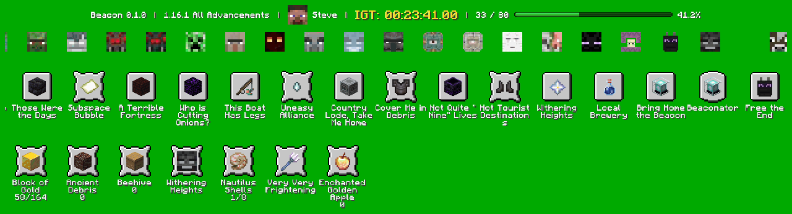
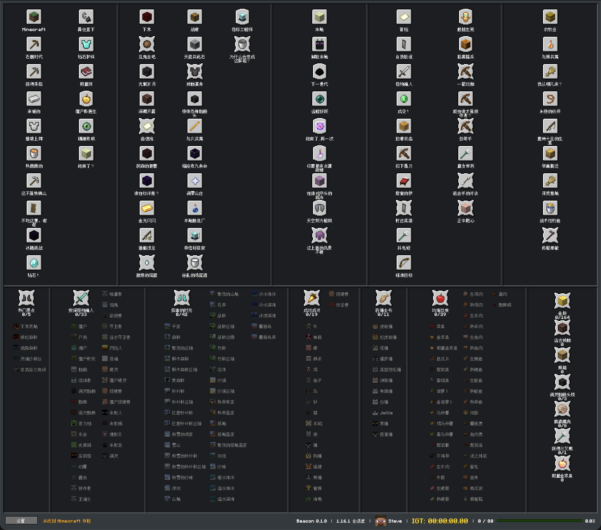

<div align="center">
  
  <h1>Beacon</h1>
  <p><strong>An advancement tracker for Minecraft speedruns.</strong></p>
  <p>
    <a href="https://github.com/liaozhangsheng/beacon/actions/workflows/ci.yml"></a>
    <a href="LICENSE"></a>
  </p>
  <p><a href="#beacon">English</a> · <a href="README_zh.md">中文</a></p>
</div>

Beacon reads Minecraft save data and turns advancements, statistics, and custom rules into a live speedrun checklist. It provides a main window, an optional overlay, and a template package format for describing your own runs.

<p align="center">
  
</p>
<p align="center">
  
</p>

## Highlights

- **Live advancement tracking** — discovers worlds and players, then refreshes the active save while you play.
- **Advancements and statistics** — reads the standard `stats/<uuid>.json` and `advancements/<uuid>.json` files without modifying the save.
- **Main window and overlay** — use the full tracker or a compact, configurable overlay during a run.
- **Version-aware templates** — each template declares the Minecraft `DataVersion` range it supports.
- **Resilient refresh** — keeps the last successful state visible when a file is temporarily unavailable or still being written.
- **Customizable runs** — define goals, rules, languages, layouts, and icons in a template package.
- **Cross-platform desktop app** — designed for Windows, macOS, and Linux.

## For users

### Getting started

1. Build or download Beacon for your platform.
2. Launch `beacon`. It starts with the bundled **1.16.1 All Advancements** template; open settings to choose your Minecraft game directory, or another template from `templates/` in the installation root (see [Custom templates](#custom-templates)).
3. Select a world and player, then start playing. Beacon updates the checklist as the save changes.

The default Minecraft directories are detected automatically:

| Platform | Default game directory |
| --- | --- |
| Windows | `%APPDATA%/.minecraft` |
| macOS | `~/Library/Application Support/minecraft` |
| Linux | `~/.minecraft` |

The installation root is the directory containing the `beacon` launcher. Beacon ships the `templates/1.16.1` template, which tracks every Minecraft Java Edition 1.16.1 advancement in Chinese and English. Without any template, it exits with `no templates found`.

The interface defaults to Chinese. In settings, change **界面语言** (Interface language) to **English** to switch the app's labels.

The **Auto detect** setting is on by default. When you switch to the Minecraft window, Beacon reads the game's `--gameDir` argument and looks for the active world under `saves`. If detection fails, Beacon keeps the current game directory. Automatic detection is supported on Windows, macOS, and Linux builds with X11 support; on Wayland, choose the directory manually. Detection requires an absolute `--gameDir` path.

### Shortcuts

| Action | Shortcut |
| --- | --- |
| Restart the run (clear manual marks and re-read the save; the save itself is not modified) | Windows/Linux: `Ctrl+R`; macOS: `Cmd+R` |
| Mark a goal done / undo a manual mark | Hold `Ctrl` on Windows/Linux or `Cmd` on macOS, then left / right click its icon |
| Move or resize the overlay | Drag the overlay / drag its edges |
| Close settings | `Esc` |

The restart and manual-mark shortcuts are also listed at the bottom of the settings window.

### Data and recovery behavior

Beacon reads save files without modifying them. Settings are stored next to the `beacon` launcher under `config/settings.json`; templates belong under `templates/` in that same directory. Installed program files and built-in assets live under `versions/<version>/`, separately from templates and settings. The skin cache is stored in the platform-specific application data directory under `cache/skins/`; skins are looked up through Mojang's session server.

The active world is checked frequently; other worlds are scanned periodically for changes. If Minecraft is still writing a file, Beacon keeps the last successfully loaded state, indicates that the data could not be refreshed, and retries. A damaged or inaccessible world is reported without interrupting tracking of the active world.

### Application updates

Full packages with update support check for signed updates in the background once at startup. If a newer version is available, an **Update to &lt;version&gt;** button appears next to Settings at the bottom left of the main window; click it to exit Beacon and apply the update. Beacon does not restart automatically. You can also close Beacon and run `updater/beacon-updater --check` followed by `--apply` (`updater\beacon-updater.exe` on Windows). Program files and assets update separately; unchanged assets are not downloaded again. Templates and user settings are never managed by the updater. Each version is installed alongside the previous one, and Beacon switches to it atomically. Failures before the switch leave the current version untouched; `--rollback` returns to the previous usable version.

## For developers

### Requirements

- A C++20 compiler
- CMake 3.21 or newer
- Git with submodule support
- Ninja for the build commands below
- Desktop app: SDL3 3.2 or newer, FreeType, and OpenSSL development libraries
- Standalone updater: OpenSSL and libarchive development libraries
- Tests: Catch2 3 or newer, Python 3, and the `openssl` command-line tool

Windows builds use the dependency manifest in [`vcpkg.json`](vcpkg.json); Linux and macOS use system packages or upstream builds. The [CI workflow](.github/workflows/ci.yml) lists the platform dependencies and compiler setup: it builds SDL3 3.2.6 from source on Ubuntu 24.04 and uses LLVM 18 on macOS. On macOS, FreeType and libarchive are available through `brew install freetype libarchive`; on Ubuntu, the corresponding packages are `libfreetype-dev` and `libarchive-dev`.

Core-only builds do not require SDL3, FreeType, OpenSSL, or libarchive. Python 3 is also used to prepare update packages; the `openssl` command-line tool is used to generate release keys and sign manifests.

### Build from source

The examples use Bash syntax. On Windows, configure the MSVC build environment and set `VCPKG_ROOT` first. Clone the repository with its submodules, then configure it with CMake:

```sh
git clone --recurse-submodules https://github.com/liaozhangsheng/beacon.git
cd beacon

cmake -S . -B build -G Ninja \
  -DCMAKE_BUILD_TYPE=Release
cmake --build build --parallel
```

On Windows, configure with the vcpkg toolchain as well:

```sh
cmake -S . -B build -G Ninja \
  -DCMAKE_BUILD_TYPE=Release \
  -DCMAKE_TOOLCHAIN_FILE="$VCPKG_ROOT/scripts/buildsystems/vcpkg.cmake" \
  -DVCPKG_TARGET_TRIPLET=x64-windows
```

Building copies the bundled templates to `build/templates/`; put your own template directories beside them. Then run:

```sh
./build/beacon
```

On Windows, run `build/beacon.exe` instead. If the submodules were cloned without `--recurse-submodules`, initialize them manually:

```sh
git submodule update --init --recursive
```

To build only the non-desktop libraries:

```sh
cmake -S . -B build-core -G Ninja \
  -DCMAKE_BUILD_TYPE=Release \
  -DBEACON_BUILD_DESKTOP=OFF \
  -DBEACON_BUILD_UPDATER=OFF
cmake --build build-core --parallel
```

### Update packages and signing

Generate an Ed25519 release key pair and embed the public key when configuring the build:

```sh
openssl genpkey -algorithm ED25519 -out release-private.pem
openssl pkey -in release-private.pem -pubout -out release-public.pem
cmake -S . -B build -DBEACON_UPDATE_PUBLIC_KEY_FILE=/absolute/path/release-public.pem
```

Keep the private key out of the repository and installation packages. For GitHub Actions releases, set the repository variable `BEACON_UPDATE_PUBLIC_KEY` to the public-key PEM and the secret `BEACON_UPDATE_SIGNING_KEY` to the matching private-key PEM. The release workflow verifies that the keys match before signing manifests.

Normal branch builds produce downloadable CI artifacts. To publish a GitHub release, push a `v<version>` tag that matches the version in `CMakeLists.txt` and `vcpkg.json`, such as `v0.1.0`. CI runs [`scripts/package_updates.py`](scripts/package_updates.py) on the CPack ZIP to produce program and assets components, a release manifest, and a full package with version metadata. The release job signs the manifest when a signing key is configured; otherwise, it omits update manifests from the release.

`cmake --build build --target package` creates a raw CPack ZIP. That ZIP lacks the metadata required for updates; distribute the generated full package instead. Builds without an embedded public key cannot download or apply updates; local rollback remains available.

### Tests and formatting

Configure with the test feature enabled, build, and run the regression suite:

```sh
cmake -S . -B build -G Ninja \
  -DCMAKE_BUILD_TYPE=Debug \
  -DBUILD_TESTING=ON
cmake --build build --parallel
ctest --test-dir build --output-on-failure
```

On Windows, add the vcpkg toolchain and `-DVCPKG_TARGET_TRIPLET=x64-windows` to the configure command.

With `clang-format` installed, check formatting with:

```sh
cmake --build build --target format-check
```

The continuous integration workflow covers Linux, Windows, and macOS: [`.github/workflows/ci.yml`](.github/workflows/ci.yml).

### Project layout

| Path | Responsibility |
| --- | --- |
| `src/core` | Template compilation, rule evaluation, and shared data models |
| `src/io` | Safe filesystem and file-change handling |
| `src/minecraft` | Save discovery plus stats and advancement parsing |
| `src/app` | Runtime refresh, persistence, and manual progress |
| `src/ui` | Presentation, layout, rendering, and desktop interaction |
| `assets` | App UI resources: `fonts/`, `widgets/`, `progress/`, `app-icon.png`, `default-avatar.png`, and `settings-background.png` |
| `test` | Core, filesystem, presentation, UI, and package checks |

### Custom templates

Templates are self-contained directories under `templates/`. The three JSON files below are required; `langs/` and `assets/` are optional:

```text
templates/<name>/
├── template.json   # goals, facts, rules, and Minecraft compatibility
├── lang.json       # localized text
├── layout.json     # main-window and overlay layout
├── langs/          # optional translations, e.g. en.json or zh-CN.json
└── assets/         # optional resources used by this template
```

`assets/` is the recommended location for template-specific resources, but any directory inside the template is allowed. `view.icon` gives the exact file path relative to the directory containing `template.json`, for example `"assets/apple.png"`. Beacon does not look up global resource names or add file extensions. Missing, empty, or unreadable icons (including corrupt GIFs), invalid paths, and symlinks that escape the template directory all display a purple-and-black missingno checkerboard without preventing the template from loading. Files outside the template directory are never loaded as icons. Copying the template directory copies its resources too.

The program bundle contains only app UI resources and fonts. Use the bundled [`beacon-custom-template` skill](.agents/skills/beacon-custom-template/SKILL.md) for the complete schema, validation rules, and examples.

`lang.json` provides the template's default text. Choose a translation from `langs/` with the **Template language** setting; missing entries fall back to `lang.json`. **Interface language** controls Beacon's own labels separately. Restart Beacon after adding templates. To reload an edited template, restart Beacon or switch to another template and back; selecting the already active template does not reload it.

Statistic counters can use `prefix` to define an ordered sequence of stages. Each direct child uses a `stat/` fact, a positive integer `target`,
and its own `view`; the layout references the parent through a group's `nodes`. The same slot shows the first unfinished
stage's icon, label, and count, then keeps the final stage highlighted when all stages are complete. In the main window,
a manual increment adds one to the displayed stage's count (and is ignored once all stages are complete); a manual decrement reduces that count,
or reopens the previous stage when the displayed count is zero. The counter keeps a fixed slot in the overlay.
Plain counters and staged counters can share a group.
These counters use cumulative save statistics, so consuming items does not reduce their counts; stages need no separate persistent state.
Picking up the same item again increases pickup statistics again, so these counts do not show how many items the player currently holds. Stages must be completed in order.

In `layout.json`, `collections` groups under `main` can configure child item styles:

```json
"item_style": {
  "pending": { "emphasis": "highlight" },
  "done": { "emphasis": "muted", "decoration": "strikethrough" }
}
```

`emphasis` accepts `highlight` or `muted`, and affects both icons and text. By default, `pending` items are `muted`
and `done` items are `highlight`. Explicit settings override these defaults.
`decoration` accepts `none` (default) or `strikethrough`; the line crosses the icon and text, including multiline labels.
`visibility` accepts `visible` (default) or `blank`. For example, `"done": { "visibility": "blank" }` keeps an empty slot
after completion and skips the icon, text, glow, decoration, and click handling. Blank items cannot be clicked to undo completion.
`blank` takes priority over emphasis and decoration. Both states and all their properties are optional and use these defaults when omitted.
Styles affect child items only, leaving collection headings and totals unchanged. Nested groups need their own styles; styles are not inherited.
The overlay uses its own completion animation and carousel behavior for collection items. Placing `item_style` in `overlay`, in a `nodes` or `prefix`
group, or in `template.json` is invalid. Unknown states, properties, enum values, and non-string property values are also rejected.

## Minecraft trademark

Minecraft is a trademark of Microsoft Corporation. Beacon is an independent, unofficial project and is not affiliated with, endorsed by, or sponsored by Mojang Studios or Microsoft.

## License

Beacon is released under the [MIT License](LICENSE). Third-party components and resources retain their own licenses and notices, including [GNU Unifont's SIL Open Font License](assets/fonts/Unifont-LICENSE.txt).

This software is based in part on the work of the [FreeType Project](https://freetype.org), used under the [FreeType License](licenses/FreeType-LICENSE.txt).
