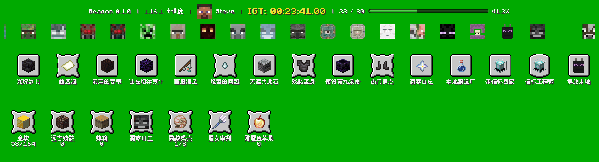
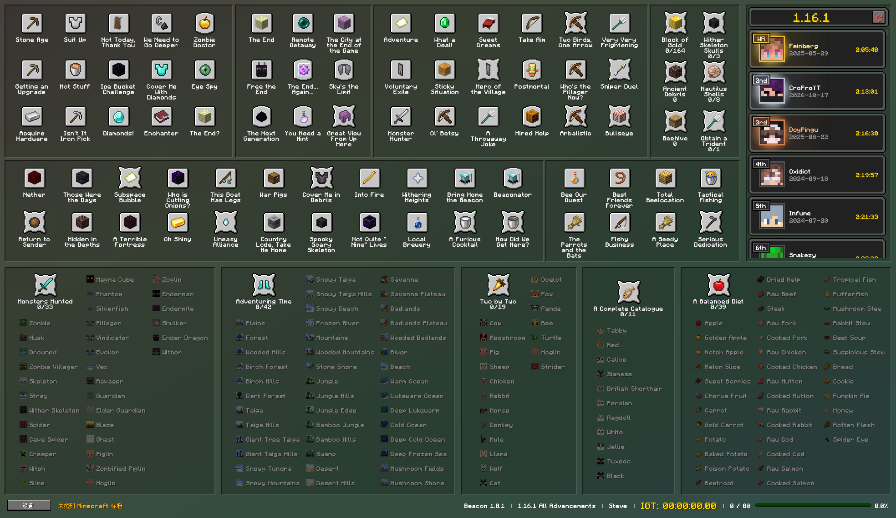

<div align="center">
  
  <h1>Beacon 中文文档</h1>
  <p>面向 Minecraft 速通的进度（Advancements）追踪器</p>
  <p><a href="README.md">English</a></p>
</div>

Beacon 是一个面向 Minecraft 速通的进度追踪器。它读取本地存档中的进度（Advancements）和统计数据，结合模板中的自定义规则，在主窗口和可选悬浮窗中实时展示目标的完成情况。你可以通过模板包配置自己的速通路线。

<p align="center">
  
</p>
<p align="center">
  
</p>

## 功能概览

- **实时追踪进度**：自动发现世界和玩家，在游戏过程中刷新当前存档。
- **读取进度与统计**：读取标准的 `stats/<uuid>.json` 和 `advancements/<uuid>.json`，不会修改存档。
- **主窗口与悬浮窗**：可以使用完整追踪界面，也可以在游戏过程中使用紧凑、可配置的悬浮窗。
- **模板版本检查**：每个模板声明支持的 Minecraft 存档 `DataVersion` 范围。
- **稳定刷新**：文件暂时不可用或仍在写入时，保留上次成功读取的状态并自动重试。
- **自定义路线**：通过模板包定义目标、规则、语言、布局和图标。
- **跨平台桌面程序**：面向 Windows、macOS 和 Linux。

## 用户指南

### 快速开始

1. 构建或下载对应平台的 Beacon。
2. 启动 `beacon`，默认使用内置的“1.16.1 全进度”模板；打开设置可选择 Minecraft 游戏目录，或安装根目录 `templates/` 下的其他模板（格式见[自定义模板](#自定义模板)）。
3. 选择世界与玩家，开始游戏；存档变化后，Beacon 会自动更新清单。

默认会自动检测以下 Minecraft 游戏目录：

| 平台 | 默认游戏目录 |
| --- | --- |
| Windows | `%APPDATA%/.minecraft` |
| macOS | `~/Library/Application Support/minecraft` |
| Linux | `~/.minecraft` |

安装根目录是 `beacon` 启动器所在目录。Beacon 附带 `templates/1.16.1` 模板，追踪 Minecraft Java 版 1.16.1 的全部进度，支持中文和英文。没有任何模板时，会以 `no templates found` 退出。

界面默认使用中文，可在设置中的“界面语言”切换为 English。

设置中的“自动探测”默认开启。切换到 Minecraft 窗口时，Beacon 会读取游戏进程的 `--gameDir` 启动参数，并在其 `saves` 目录中查找正在游玩的世界。探测失败时保留当前游戏目录。自动探测支持 Windows、macOS 和启用 X11 支持的 Linux 构建；Wayland 请手动填写目录。探测要求 `--gameDir` 使用绝对路径。

### 快捷操作

| 操作 | 方式 |
| --- | --- |
| 重开本轮（清除手动标记并重新读取存档，不修改存档） | Windows/Linux：`Ctrl+R`；macOS：`Cmd+R` |
| 手动标记完成 / 撤销手动标记 | Windows/Linux 按住 `Ctrl`，macOS 按住 `Cmd`，左键 / 右键点击图标 |
| 移动悬浮窗或调整大小 | 拖动悬浮窗 / 拖动其边缘 |
| 关闭设置窗口 | `Esc` |

设置窗口底部也列出了重开本轮和手动标记的快捷键提示。

设置中可以分别指定主窗口和悬浮窗的宽高（1–16384 逻辑像素），点击“保存”后生效。拖动窗口边缘调整大小后约 500ms 会自动保存，下次启动恢复；最大化或最小化不会覆盖正常尺寸。悬浮窗会根据布局和缩放计算最小高度，仅在高度不足时撑高，保留更大的手动尺寸；宽度或主窗口高度过小时，内容和操作按钮可能被裁剪。

### 数据与异常恢复

Beacon 只读取存档，不会修改存档文件。设置保存在 `beacon` 启动器旁的 `config/settings.json`，模板放在同一目录下的 `templates/`。安装后的程序文件和内置资源位于 `versions/<版本>/`，与模板、设置分开存放。下载的皮肤和排行榜缓存在同一目录下的 `cache/`，皮肤通过 Mojang 官方接口查询。
联网时优先使用 `HTTPS_PROXY` 或 `ALL_PROXY` 环境变量（遵循 `NO_PROXY`），否则在 macOS 和 Windows 上使用系统的 HTTPS 代理；代理需为支持 `CONNECT` 的 HTTP 代理。

程序会频繁检查当前世界，并定期扫描其他世界的变化。如果 Minecraft 正在写入文件，Beacon 会保留上次成功读取的状态，提示数据暂时无法刷新，并自动重试。其他世界损坏或无法访问时，程序会单独提示，不会中断当前世界的追踪。

### 程序更新

支持更新的完整发布包会在启动时后台检查一次签名更新。发现新版本后，主窗口左下角“设置”旁会出现“更新到 <版本>”按钮；点击即可退出 Beacon 并应用更新，更新后需要手动重新启动 Beacon。也可以关闭 Beacon 后手动运行 `updater/beacon-updater --check` 再运行 `--apply`；Windows 使用 `updater\beacon-updater.exe`。程序与资源分别更新，未变化的资源不会重复下载；模板和用户设置不由更新器管理。每个版本安装在上一版本旁边并原子切换。切换前失败时当前版本保持不变；`--rollback` 可回到上一个可用版本。

## 开发者指南

### 环境要求

- C++20 编译器
- CMake 3.21 或更高版本
- 支持子模块的 Git
- Ninja，用于下方构建命令
- 桌面程序：SDL3 3.2 或更高版本、FreeType 和 OpenSSL 开发库
- 独立更新器：OpenSSL 和 libarchive 开发库
- 测试：Catch2 3 或更高版本、Python 3 和 `openssl` 命令行工具

Windows 和 macOS 的发布构建使用 [`vcpkg.json`](vcpkg.json) 中的依赖清单，其中的 `builtin-baseline` 固定了所有依赖的版本；CI 会把 vcpkg 检出到该提交（triplet 分别为 `x64-windows` 和 `arm64-osx-dynamic`）。Linux 使用 Ubuntu 24.04 的软件包，并从源码构建 SDL3 3.2.6。[CI 工作流](.github/workflows/ci.yml) 列出了各平台的依赖和编译器配置，包括 macOS 使用的 LLVM 18。在本地构建 macOS 版本时，也可以使用 Homebrew 的 `freetype libarchive openssl@3 sdl3`；Ubuntu 对应的软件包是 `libfreetype-dev` 和 `libarchive-dev`。

仅构建核心库时不需要 SDL3、FreeType、OpenSSL 或 libarchive。生成更新包还需要 Python 3；生成发布密钥和签名清单还需要 `openssl` 命令行工具。

### 从源码构建

下方示例使用 Bash 语法。Windows 请先配置 MSVC 构建环境并设置 `VCPKG_ROOT`。先克隆仓库及其子模块，再使用 CMake 配置：

```sh
git clone --recurse-submodules https://github.com/liaozhangsheng/beacon.git
cd beacon

cmake -S . -B build -G Ninja \
  -DCMAKE_BUILD_TYPE=Release
cmake --build build --parallel
```

Windows 下还需要在配置时加入 vcpkg 工具链（macOS 使用 `-DVCPKG_TARGET_TRIPLET=arm64-osx-dynamic` 即可基于固定版本的依赖构建）：

```sh
cmake -S . -B build -G Ninja \
  -DCMAKE_BUILD_TYPE=Release \
  -DCMAKE_TOOLCHAIN_FILE="$VCPKG_ROOT/scripts/buildsystems/vcpkg.cmake" \
  -DVCPKG_TARGET_TRIPLET=x64-windows
```

构建时会把内置模板复制到 `build/templates/`，自己的模板目录放在旁边即可。然后运行：

```sh
./build/beacon
```

Windows 下运行 `build/beacon.exe`。如果克隆时没有使用 `--recurse-submodules`，可以手动初始化子模块：

```sh
git submodule update --init --recursive
```

只构建不依赖桌面的核心库：

```sh
cmake -S . -B build-core -G Ninja \
  -DCMAKE_BUILD_TYPE=Release \
  -DBEACON_BUILD_DESKTOP=OFF \
  -DBEACON_BUILD_UPDATER=OFF
cmake --build build-core --parallel
```

### 更新包与签名

生成 Ed25519 发布密钥，并在构建配置中嵌入公钥：

```sh
openssl genpkey -algorithm ED25519 -out release-private.pem
openssl pkey -in release-private.pem -pubout -out release-public.pem
cmake -S . -B build -DBEACON_UPDATE_PUBLIC_KEY_FILE=/absolute/path/release-public.pem
```

私钥不得提交到仓库或放入安装包。使用 GitHub Actions 发布时，将公钥 PEM 保存到仓库变量 `BEACON_UPDATE_PUBLIC_KEY`，将匹配的私钥 PEM 保存到 Secret `BEACON_UPDATE_SIGNING_KEY`。发布工作流会先验证密钥是否匹配，再签名清单。

普通分支构建会生成可下载的 CI 产物。发布 GitHub Release 时，推送与 `CMakeLists.txt` 和 `vcpkg.json` 中版本一致的 `v<版本>` 标签，例如 `v1.0.0`。CI 用 [`scripts/package_updates.py`](scripts/package_updates.py) 处理 CPack ZIP，生成程序组件、资源组件、发布清单和带版本元数据的完整包。配置了签名私钥时，发布任务会签名清单；未配置时，发布内容不包含更新清单。

`cmake --build build --target package` 生成的是原始 CPack ZIP，缺少更新所需的元数据；分发时应使用后续生成的完整包。未嵌入公钥的构建不能下载或应用更新，但仍可在本地回滚。

### 测试与格式检查

启用测试特性、构建并运行回归测试：

```sh
cmake -S . -B build -G Ninja \
  -DCMAKE_BUILD_TYPE=Debug \
  -DBUILD_TESTING=ON
cmake --build build --parallel
ctest --test-dir build --output-on-failure
```

Windows 下请在配置命令中同时加入 vcpkg 工具链和 `-DVCPKG_TARGET_TRIPLET=x64-windows`。

安装 `clang-format` 后，可以检查代码格式：

```sh
cmake --build build --target format-check
```

持续集成工作流覆盖 Linux、Windows 和 macOS：[`.github/workflows/ci.yml`](.github/workflows/ci.yml)。

### 项目结构

| 路径 | 职责 |
| --- | --- |
| `src/core` | 模板编译、规则求值和共享数据模型 |
| `src/io` | 安全文件访问与文件变化处理 |
| `src/minecraft` | 存档发现、统计和进度解析 |
| `src/app` | 运行时刷新、持久化和手动进度 |
| `src/ui` | 展示、布局、渲染和桌面交互 |
| `assets` | 程序界面资源：`fonts/`、`widgets/`、`progress/`、`app-icon.png`、`default-avatar.png` 和 `settings-background.png` |
| `test` | 核心、文件系统、展示、界面和打包检查 |

### 自定义模板

模板是 `templates/` 下的独立目录。下面三个 JSON 文件是必需的，`langs/` 和 `assets/` 目录可选：

```text
templates/<name>/
├── template.json   # 目标、事实、规则和 Minecraft 兼容范围
├── lang.json       # 本地化文本
├── layout.json     # 主窗口与悬浮窗布局
├── langs/          # 可选翻译，例如 en.json 或 zh-CN.json
└── assets/         # 此模板使用的可选资源
```

推荐将模板专用资源放在 `assets/` 下，也可以使用模板内部的其他目录。`view.icon` 填写相对于 `template.json` 所在目录的精确文件路径，例如 `"assets/apple.png"`。Beacon 不查询全局资源名，也不会自动补充扩展名。省略图标、路径为空、文件缺失、图片无法读取（包括损坏的 GIF）、非法路径或符号链接越界时，统一显示紫黑棋盘格 missingno，不影响模板加载。程序不会加载模板目录外的文件作为图标。GIF 和带动画的 PNG（APNG）图标会播放动画。复制整个模板目录即可一并分享其中的资源。

程序包只包含界面所需资源和字体。完整格式、校验规则和示例请参阅内置的 [`beacon-custom-template` skill](.agents/skills/beacon-custom-template/SKILL.md)。

`lang.json` 提供模板的默认文本。设置中的“模板语言”可选择 `langs/` 下的翻译，缺失条目回退到 `lang.json`；“界面语言”单独控制 Beacon 自身的文字。新增模板后需重启程序。修改已有模板后，应重启程序，或先切换到其他模板再切回；直接选择当前模板不会触发重新加载。

统计计数器可用 `prefix` 配置有序的多个阶段。每个直接子项使用一个 `stat/` 事实、正整数 `target` 和自己的 `view`，
布局在分组的 `nodes` 中引用父节点。同一个位置显示首个未完成阶段的图标、名称和数量，全部完成后保留最后阶段并高亮；
主窗口的手动加一增加当前阶段的计数，全部完成后不再增加；手动减一减少当前阶段的计数，当前计数为 0 时重新打开上一阶段。计数器在悬浮窗中保持固定位置。普通计数器可与多阶段计数器放在同一组。
各阶段使用存档中的累计统计，消耗物品不会减少计数，也无需单独持久化阶段状态。
重复捡起同一物品也会增加拾取统计，因此这些计数不代表当前持有量。各阶段必须依次完成。

每条规则在 `template.json` 的 `view.state_style` 中分别配置主窗口与悬浮窗的状态样式：

```json
"state_style": {
  "main": {
    "pending": {"emphasis": "highlight"},
    "done": {"emphasis": "muted", "decoration": "strikethrough"}
  },
  "overlay": {
    "done": {"visibility": "visible"}
  }
}
```

窗口、状态（`pending` 未完成、`done` 完成）和每个属性都可省略。`main` 与 `overlay` 独立，
条目不继承父规则、`ref` 引用对象或当前阶段、轮换子项的样式。
`emphasis` 支持 `highlight`（高亮）和 `muted`（变暗），影响图标与文字。主窗口收集组子项未完成时默认变暗，其余默认高亮。
`visibility` 支持 `visible`（显示）、`blank`（留空位）、`hidden`（移除并让后面的项目补位）。
悬浮窗完成时默认 `hidden`，其余默认 `visible`。`done` 中的可见性和明暗决定动画结束后的最终效果。
`overlay.done.animation` 支持 `cover`（自下而上遮盖）和 `none`（直接应用最终样式），仅允许写在 `overlay.done`。
最终为 `visible` 的条目始终不播放退场动画，即使写了 `"animation": "cover"`，也立即应用完成样式。
最终为 `blank` 或 `hidden` 的条目省略动画字段时默认播放遮盖动画。
动画沿用现有的 0.6 秒等待、1 秒遮盖；例如完成后播放遮盖，再移除：

```json
"overlay": {
  "done": {"animation": "cover", "visibility": "hidden"}
}
```

改为 `"visibility": "blank"` 会在动画结束后留空位；设为 `"animation": "none"` 则立即应用最终效果。
只有布局实际显示且启用动画的条目会播放并等待动画；撤销完成会中止动画。主窗口立即应用状态样式，留空或隐藏的项目无法点击撤销完成。
`decoration` 在 `main` 中支持 `none`（默认）和 `strikethrough`（删除线），仅主窗口文字在图标右侧的收集组子项生效；`overlay` 不接受该属性。
未知窗口、状态、属性、枚举值和非字符串属性值均会被拒绝。
`layout.json` 的 `main`、`overlay` 各放一个布局对象，两者都可省略。`hbox` 从左到右排列，`vbox` 从上到下排列，
可以互相嵌套。子块按正数 `stretch`（默认 1）分配父布局主方向的空间，另一方向铺满。
`spring: true` 是透明弹簧，按同样的权重占空间但不绘制。容器的 `gap`（源图标像素，默认 0）在相邻子块之间留出固定间隔，子块分剩下的空间。子块也可以用固定的 `size`（源图标像素）代替 `stretch`，
窗口缩放时保持这个尺寸，其余子块按 `stretch` 分剩下的空间。容器只接受 `id`、`stretch`、`size`、`gap`、`frame` 和 `hbox` 或 `vbox`；
弹簧只接受 `spring: true`、`stretch`、`size`。内容块继续使用原有的 `margin`、`padding`、项目 `spacing` 和悬浮窗 `scroll`，
块内图标和收集组仍然自动排列。

```json
{
  "main": {
    "vbox": [
      {"stretch": 5, "hbox": [
        {"stretch": 2, "prefix": ["goal/story_"]},
        {"spring": true},
        {"prefix": ["goal/nether_"]}
      ]},
      {"stretch": 4, "collections": ["goal/adventure_kill_all_mobs"]}
    ]
  }
}
```

上面两行高度为 5:4，第一行宽度为 2:1:1（中间弹簧留空）。空容器不绘制，空对象是空面板。
不支持旧窗口数组和 `x`、`y`、`width`、`height`、`children` 字段，已有模板需要改写。

`main` 中用 `"leaderboard"` 代替 `nodes` 的分组会显示公开 Google 表格中的一个榜单，例如
[26.x](https://docs.google.com/spreadsheets/d/1v7tpe9jJp1cENpwtwJp4Hrn6c1RVniQI4vyyllQwU-A) 或
[1.16.1 及其他版本](https://docs.google.com/spreadsheets/d/107ijqjELTQQ29KW4phUmtvYFTX9-pfHsjb18TKoWACk)社区排行榜，
位置和大小与其他分组一样设置：

```json
{"id": "Leaderboard", "stretch": 6, "padding": 6,
 "leaderboard": {"sheet": "1v7tpe9jJp1cENpwtwJp4Hrn6c1RVniQI4vyyllQwU-A", "gid": 1283472797, "board": "26.2 - 26.3"}}
```

`sheet` 是表格网址中的 ID，`gid` 是工作表网址中 `#gid=` 后的数字（省略时为 0）。工作表中榜单并排排列，每个榜单的标题在表头行上方，
表头从 `#` 开始并包含 `Runner` 和 `IGT` 列（`Date`、`Link`、`Status` 可选，`Rejected` 的记录不显示）。`board` 按标题选择榜单，
省略时取工作表中的第一个榜单；`title` 替换顶部显示的文字，默认为榜单标题。

点击记录会打开对应的视频或 speedrun.com 页面。前 50 名会联网加载头像，其余只显示已缓存的头像。表格和玩家头像会被缓存，离线时仍显示上次下载的榜单。
排行榜分组不支持 `exclude`、`spacing`，也不能放在 `overlay` 中。

## Minecraft 商标声明

Minecraft 是 Microsoft Corporation 的商标。Beacon 是独立的非官方项目，与 Mojang Studios 或 Microsoft 没有关联，也未获得其认可或赞助。`assets/` 和 `templates/` 中附带的贴图来自 Minecraft，版权归 Mojang AB / Microsoft 所有，依据 [Minecraft 使用准则](https://www.minecraft.net/usage-guidelines)使用，不适用 Beacon 的许可证，具体文件见 [NOTICE.txt](NOTICE.txt)。

## 许可证

Beacon 使用 [MIT License](LICENSE) 发布。第三方组件和资源仍适用其各自的许可证与声明，包括 [GNU Unifont 的 SIL Open Font License](assets/fonts/Unifont-LICENSE.txt)。安装包在 `versions/<版本>/licenses/` 和 `updater/licenses/` 中附带了每个捆绑库的许可证，[NOTICE.txt](NOTICE.txt) 对此做了汇总。

本软件部分基于 [FreeType 项目](https://freetype.org)的工作，并按照 [FreeType License](https://freetype.org/license.html) 使用。
